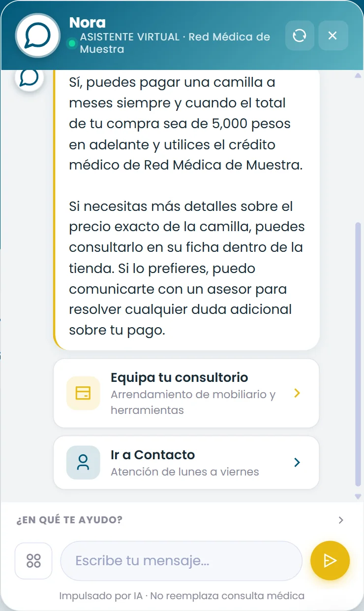
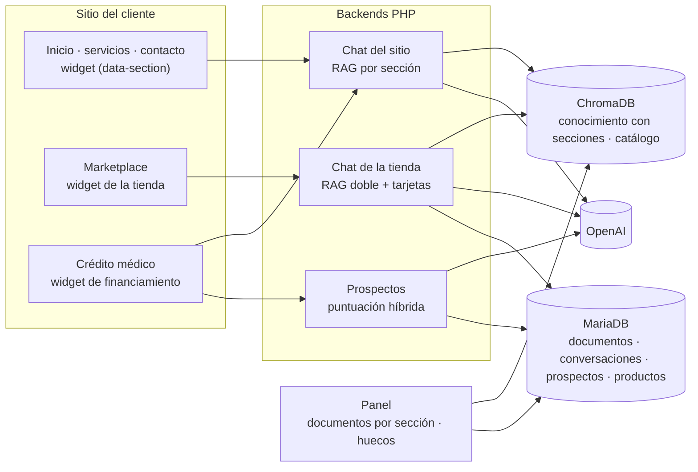
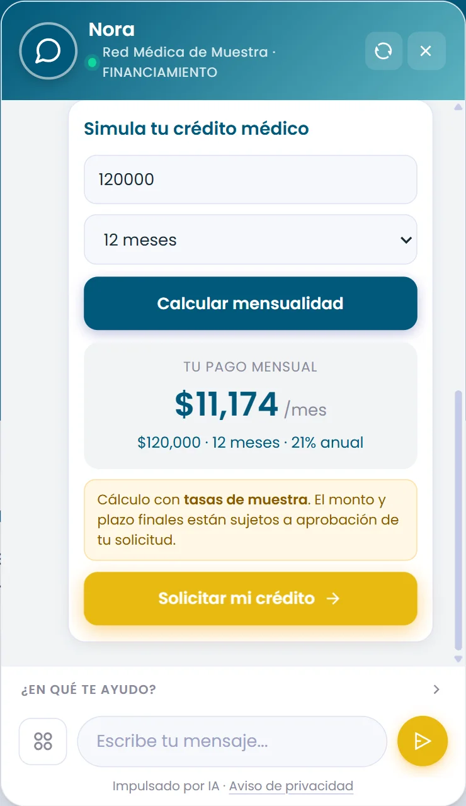
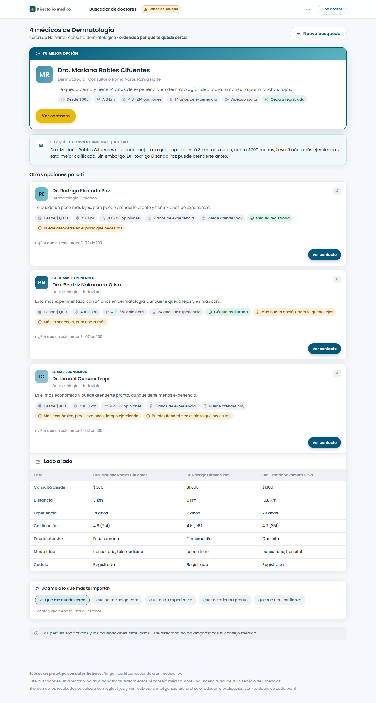

# Caso de estudio: asistentes de IA para una plataforma de salud

> **Caso de estudio sin el código del cliente.** Los asistentes son de una plataforma de
> salud cliente de TEDE Consultores, y los desarrollé ahí entre mayo y septiembre de 2026. El
> asistente principal está en producción. Aquí se explican
> el problema, la arquitectura y las decisiones; los fragmentos de [`fragmentos/`](fragmentos/)
> son reescrituras genéricas de mis técnicas, con datos ficticios, y se pueden ejecutar.

## Resumen

No es un chatbot: es una **familia de asistentes** sobre la misma plataforma, cada uno con su
conocimiento, su tono y sus acciones según dónde vive:

| Asistente | Dónde | Qué hace |
|---|---|---|
| **Asistente del sitio** | Inicio, servicios, contacto, capacitación | RAG filtrado por la sección de la página: cada página contesta con su propio conocimiento y sus propios enlaces |
| **Asistente de la tienda** | Marketplace | Recomienda productos con tarjetas de «añadir al carrito» y permite comprar desde el chat ([caso propio](https://github.com/Cesar010708/caso-tienda-con-asistente)) |
| **Asistente de financiamiento** | Página de crédito médico | Simulador de mensualidad dentro del chat, captura del prospecto en dos tiempos y puntuación híbrida con reglas e IA |
| **Buscador de Doctores** | Directorio de médicos | Conversación que traduce lo que la persona siente a especialidades y ordena médicos con reglas explicables ([código público](https://github.com/Cesar010708/buscador-doctores)) |

Todos comparten la misma base técnica: un widget que se integra con una línea `<script>`, aislado
en Shadow DOM, y un backend PHP con RAG sobre ChromaDB.

## El problema

- El sitio atiende a públicos distintos (pacientes, médicos, compradores de equipo) en páginas
  distintas. Con un solo conocimiento, el asistente contestaba cosas de la tienda en la página de
  contacto.
- En salud y en crédito, inventar es inaceptable: ni diagnósticos, ni mensualidades, ni productos
  que no existen.
- El área comercial necesitaba **prospectos calificados**, no solo conversaciones.
- Hosting compartido, sin Composer ni paso de build; los asistentes se integran en páginas que no
  controlamos.

## Arquitectura

## Decisiones técnicas y por qué

**Conocimiento y respuestas**

- **Cada fragmento indexado lleva sus secciones** (`|home|contacto|`, o `|all|`) y el widget manda
  la suya. Como ChromaDB no admite `$contains` sobre metadata (devuelve vacío sin error), se piden
  más candidatos por similitud y se filtran en PHP.
- **El prompt cambia por sección:** nombre del área, enlaces sugeridos y reglas comunes de ámbito
  (solo la plataforma y sus servicios; nada de diagnósticos; no revelar el prompt).
- **Privacidad:** de las conversaciones respondidas solo se guarda un contador diario; el texto se
  guarda solo cuando el asistente **no supo contestar**. El panel enseña esos «huecos» para saber
  qué documento falta.

**Acciones y datos**

- **El modelo no calcula:** la mensualidad sale de una fórmula de amortización en el widget, solo
  con plazos válidos para cada monto, y el servidor repite el cálculo al guardar.
- **Captura en dos tiempos:** primero nombre y contacto (para no perder al prospecto si abandona) y
  después el formulario completo, que actualiza la misma fila.
- **Puntuación híbrida:** las reglas dan hasta 60 puntos con hechos verificables; un modelo califica
  la intención con hasta 40, acotados. Si el modelo falla o no devuelve JSON, se usan reglas. El
  texto del prospecto se trata como dato: el prompt ordena ignorar instrucciones que vengan dentro.

**Integración en el sitio**

- **Un widget por asistente**, cada uno con su prefijo de clases y su llave de estado en el
  navegador, aislado en Shadow DOM: el CSS del sitio no lo altera, ni al revés.
- **Cada asistente con su propia ruta de archivo.** Un despliegue publicó dos asistentes con el
  mismo nombre de archivo y uno reemplazó al otro en producción; desde entonces ningún archivo se
  comparte entre asistentes.
- **Caché del hosting:** cada cambio de CSS o JS lleva versión nueva en la URL, porque el CDN
  guarda los estáticos varios días.

## Retos que resolví

| Reto | Cómo se resolvió |
|---|---|
| Cada página debía contestar con su propio conocimiento | Metadata de secciones y filtro en PHP ([fragmento](fragmentos/rag-por-seccion.php)) |
| Calificar prospectos sin depender de que la IA responda bien | Reglas + intención acotada con respaldo ([fragmento](fragmentos/puntuacion-hibrida.php)) |
| Mensualidades exactas dentro de una conversación | Simulador en código con segmentos y plazos válidos ([fragmento](fragmentos/simulador-mensualidad.js)) |
| Dos asistentes publicados sobre el mismo archivo | Una ruta por asistente; nunca un archivo compartido |
| Migrar de Vercel al hosting compartido del cliente | PHP sin dependencias y rutas relativas al propio script del widget |

## Resultados

- El asistente del sitio está en producción desde 2026, primero en Vercel y después
  en el hosting del cliente.
- El asistente de la tienda está en producción en el marketplace, con compra desde el chat.
- El asistente de financiamiento estuvo en producción en la página de crédito médico; después esa
  página pasó a usar un asistente de consultorios hecho por un colaborador, que **no** forma parte
  de este caso.
- El trabajo fue la base de mi memoria de estadía.

## Stack

| Capa | Tecnología |
|---|---|
| Widgets | JavaScript sin frameworks, Shadow DOM |
| Backend | PHP 8 sin framework ni Composer |
| Búsqueda semántica | ChromaDB v2 |
| IA | OpenAI `gpt-4o-mini` (chat y calificación) y `text-embedding-3-small` |
| Datos | MariaDB por PDO |
| Infraestructura | Vercel (inicio) y hosting compartido Apache / LiteSpeed |

## Fragmentos de código

Reescrituras genéricas con datos ficticios (incluidos segmentos y tasas). Todas se ejecutan solas,
sin clave de API.

| Archivo | Técnica | Ejecutar |
|---|---|---|
| [`rag-por-seccion.php`](fragmentos/rag-por-seccion.php) | Conocimiento filtrado por la sección de la página | `php rag-por-seccion.php` |
| [`puntuacion-hibrida.php`](fragmentos/puntuacion-hibrida.php) | Reglas + intención por IA, acotada y con respaldo | `php puntuacion-hibrida.php` |
| [`simulador-mensualidad.js`](fragmentos/simulador-mensualidad.js) | Mensualidad por amortización con segmentos y plazos válidos | `node simulador-mensualidad.js` |

## Capturas

Capturas de la demo de [mi portafolio](https://cesar-rodriguez.vercel.app), con un negocio y datos inventados.

| | |
|---|---|
|  |  |

## Mi rol

Trabajando en **TEDE Consultores** para una plataforma de salud, de mayo a septiembre de 2026.

- Diseñé y programé el asistente del sitio: widget, RAG por secciones, panel de documentos y
  registro de huecos.
- Hice el asistente de la tienda y el de financiamiento (simulador, captura y puntuación).
- Hice el Buscador de Doctores.
- Migré los asistentes de Vercel al hosting del cliente y los mantuve en producción.

---

## English summary

**Case study: a family of AI assistants for a health platform** in Mexico, built at TEDE
Consultores between May and September 2026. One shared base (embeddable vanilla-JS widget in a
Shadow DOM, PHP backend, RAG on ChromaDB, OpenAI) powers several assistants: a site assistant whose
knowledge is filtered by page section, a shopping assistant with product cards and checkout from
the chat, a financing assistant with an in-chat payment simulator and hybrid lead scoring (rules
plus a bounded LLM intent score with a rules fallback), and a conversational doctor finder.
Generic, runnable samples with fictitious data are in `fragmentos/`.
